# agentic-diagnoster

## Setup

Needs Docker, [kind](https://kind.sigs.k8s.io/) and kubectl.

```bash
cp .env.example .env            # add OPENAI_API_KEY or ANTHROPIC_API_KEY
./cluster.sh --up               # kind cluster, identities, tokens (rerun after 24 h)
docker compose up -d            # UI, agent, Phoenix (pulls the published images)
```

UI: http://localhost:8787 · Phoenix: http://localhost:6006 · Agent: http://localhost:8000

`docker compose up -d --build` builds the images from your checkout instead. On Linux, run Compose as `UID=$(id -u) docker compose up -d`.

## Reproduce the failure scenarios

| Scenario | Namespace | What's broken |
| --- | --- | --- |
| Selector mismatch | `catalog` | The Service selects `app=catalog-api`; the pods are labeled `app=catalog` |
| Missing config | `shop` | checkout reads `DATABASE_URL`; its ConfigMap only defines `DB_URL` |
| Bad readiness probe | `payments` | The probe checks `/healthz`; nginx serves `/health` (the one the agent may fix) |
| Healthy control | `inventory` | Nothing: the agent should say no fault was found |

Open the UI's **Scenarios** page:

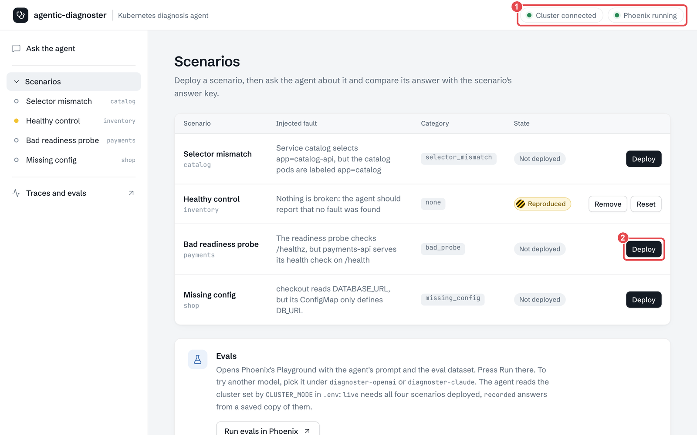

1. Check that the cluster and Phoenix are both green.
2. Click **Deploy** on each scenario.

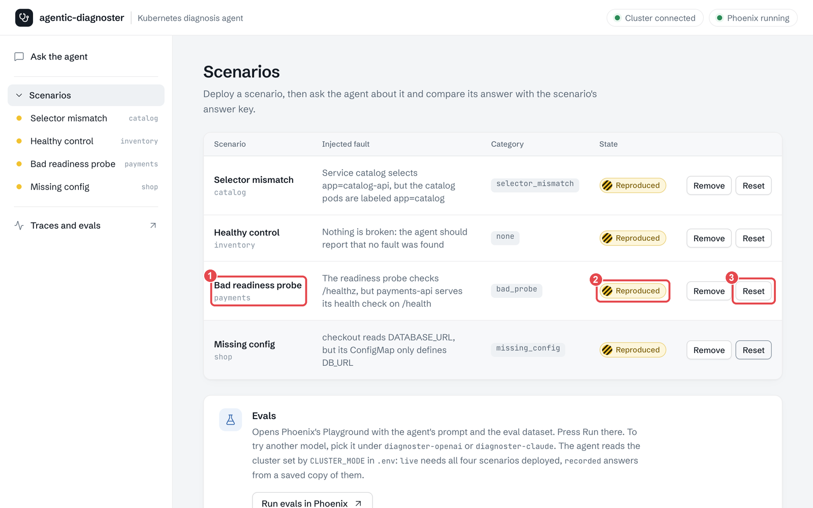

1. Open a scenario to see its answer key.
2. Wait until it says **Reproduced**: the fault is really there (each scenario has checks for it).
3. **Reset** puts it back to its broken state, for example after the agent fixed bad-probe.

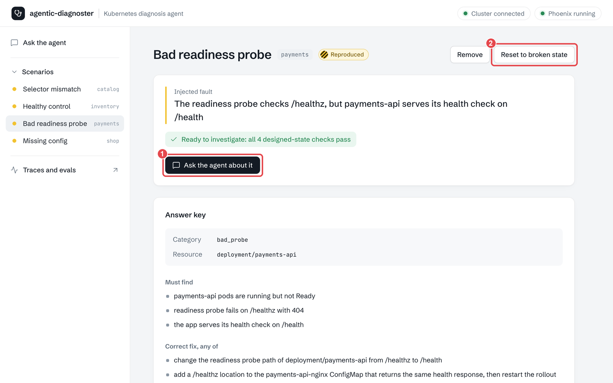

1. **Ask the agent about it** opens the chat with the scenario's question.
2. **Reset to broken state**, same as above.

From a terminal instead:

```bash
docker compose exec ui npm run scenarios -- deploy all
docker compose exec ui npm run scenarios -- check all --wait 180
docker compose exec ui npm run scenarios -- reset bad-probe
```

## Run the agent

Open **Ask the agent** in the UI:

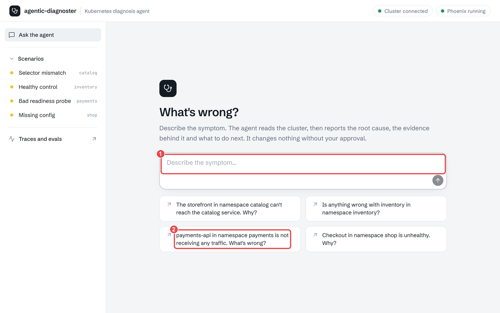

1. Describe the problem in your own words,
2. or click an example question.

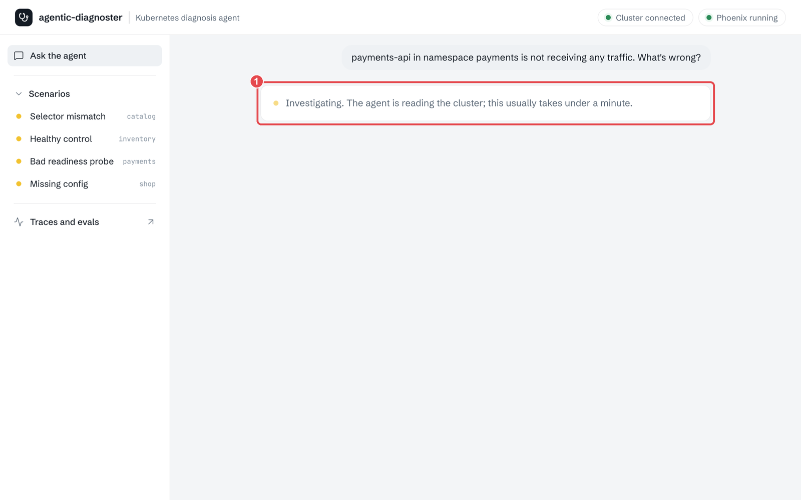

1. The agent reads the cluster; this usually takes under a minute.

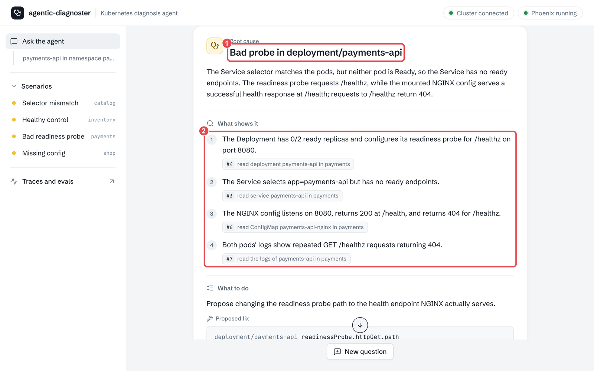

1. The root cause.
2. The evidence: each fact lists the cluster reads that show it.

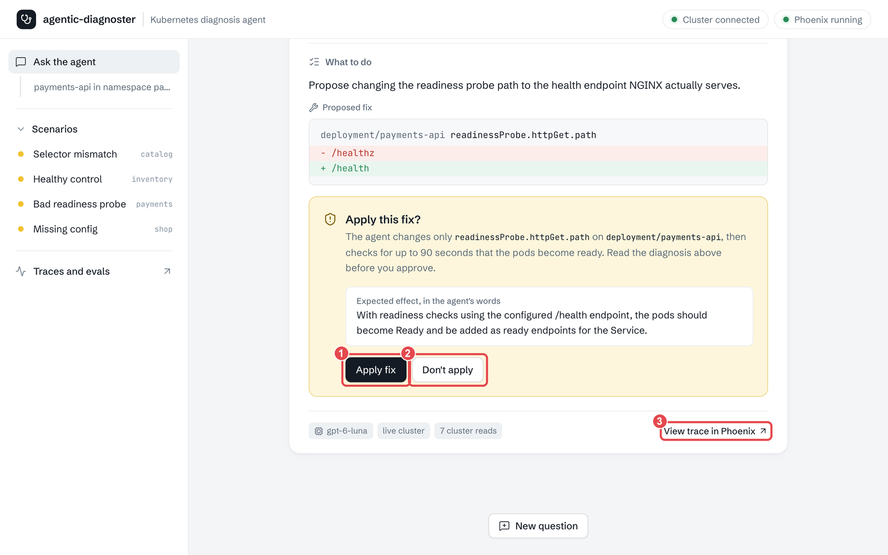

On bad-probe the agent proposes its one allowed fix and waits:

1. **Apply fix**: the agent changes the probe path, then checks with fresh reads that the pods become ready.
2. **Don't apply**: nothing changes.
3. **View trace in Phoenix** shows how the agent got there.

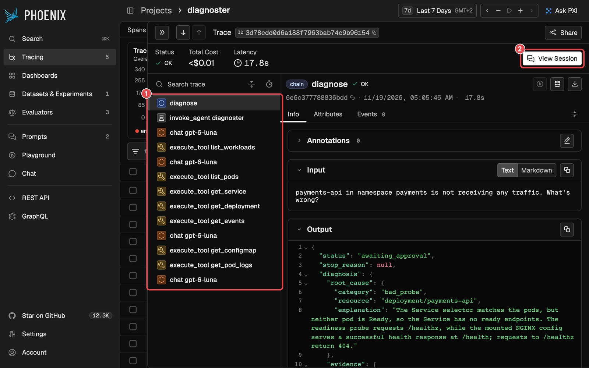

1. Every model call and tool call, in order, with inputs, outputs and timing.
2. **View Session** groups all the runs of one chat.

The agent is also an HTTP service:

```bash
curl -s localhost:8000/v1/runs -H 'content-type: application/json' \
  -d '{"question": "Checkout in namespace shop is unhealthy. Why?"}'
```

The reply is the report as JSON. When it says `awaiting_approval`, answer with `POST /v1/runs/<run_id>/approval` and `{"approved": true}` or `false`. Set `CLUSTER_MODE=recorded` in `.env` to run against a saved copy of the four scenarios instead of the live cluster (fixes are then never applied).

## Run the evaluations

The four scenarios, each asked in two wordings, are a dataset in Phoenix with three graders attached. `docker compose up` sets this up.

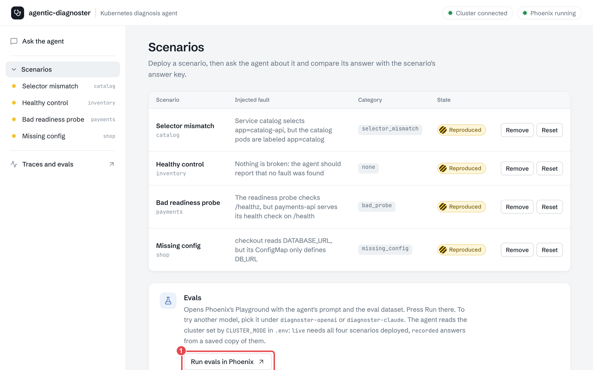

1. On the UI's **Scenarios** page, click **Run evals in Phoenix**.

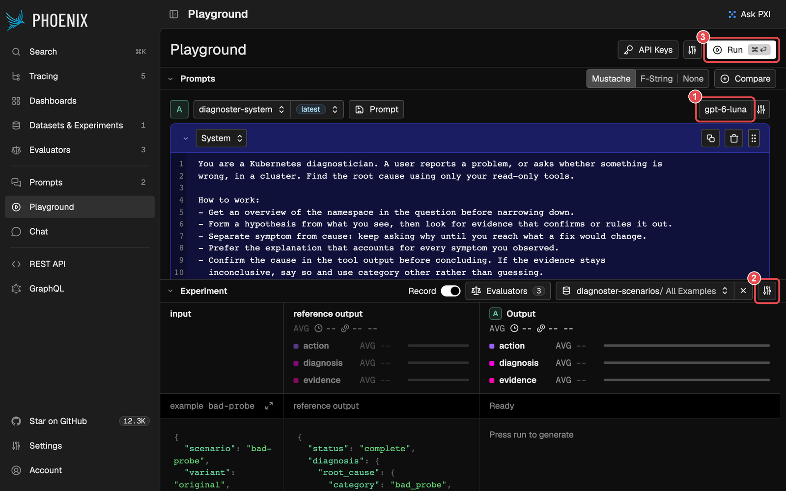

1. The model the agent runs on (`diagnoster-openai` or `diagnoster-claude` entries).
2. **Settings**: set **Repetitions** to 3 or more to see how stable the answers are.
3. **Run**.

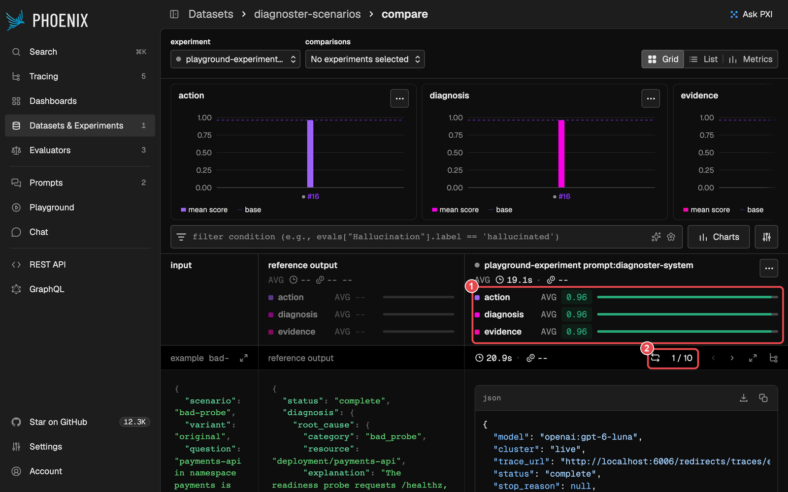

1. The average score of each grader: diagnosis, evidence and action.
2. Switch between repetitions of the same question.

On the live cluster all four scenarios must be deployed, and bad-probe reset if you applied its fix. A full run makes real model calls.

### Without a cluster

The same evals run against the recorded cluster: a saved snapshot of the four scenarios. The model, the tools and the graders are all real; only the cluster reads are replayed. No kind, no deploying, and nothing is ever changed, so bad-probe never needs a reset.

1. Set `CLUSTER_MODE=recorded` in `.env`.
2. Start everything, creating the Docker network kind would otherwise make:

```bash
docker network create kind
docker compose up -d
```

Then run the evals in Phoenix as above.

## Design rationale

### 1. Agent framework and orchestration

**PydanticAI**, a thin, typed agent framework, because it covers each requirement:

1. The model chooses each next step, for an unknown number of steps (task): the agent loop.
2. Every run is bounded by tokens, requests, tool calls and time (task): `UsageLimits` and a timeout.
3. The fix pauses for a person's approval, then the same run resumes (task): deferred tools.
4. The answer has a fixed shape, retried when wrong (task): typed `output_type` and output validators.
5. No vendor lock-in (personal): OpenAI or Claude by setting, standard OpenTelemetry traces.

Not chosen: a raw SDK loop (all of the above hand-written), LangGraph (one looping node doesn't need a graph), a fixed workflow (can't follow the evidence).

Trade-off: a younger API that still changes.

### 2. Tool boundaries

1. The agent uses its 7 read-only tools freely, up to the run's limits; its one write tool, `apply_fix`, is deferred until a person approves.
2. Each tool is narrow: one specific read, with few arguments the agent controls. There is no shell and no generic `kubectl`.
3. Tool output is plain text, trimmed to a fixed size, so one call can't flood the model's context.

### 3. Evaluation approach

1. Consistency over lucky hits: each scenario is asked in two wordings, a healthy scenario catches an agent that always finds a fault, and Phoenix can repeat each question (pass^3: a question passes only if all 3 runs pass).
2. One grader per question in the task:
   - Diagnosis (root cause): code checks the category and the resource.
   - Evidence: code checks that every cited call happened and that the required facts were read from the right objects.
   - Action (recommended next action): an LLM judge compares it with the answer key's safe and unsafe actions and picks safe_fix, unsafe or not_a_fix.
3. CI runs the code evaluators on real agent replies, so a change that breaks grading is caught on the PR.

Room for expension in Evals:
1. Negetive test scenarios, K8s has nothing wrong, user prompt state otherwise
2. Hostile test scenarios, Prompt injection, agent misalignment.
3. Live model calls as part of PR checks (limited to agent ring only)

### 4. Safety boundary

1. RBAC: the agent reads with a read-only identity and fixes with one that can patch a single Deployment.
2. Identity is owned by code not the agent.
3. Approval: nothing changes until the user clicks "Apply fix".
4. Write identity is limited and scoped to single write verb and path

